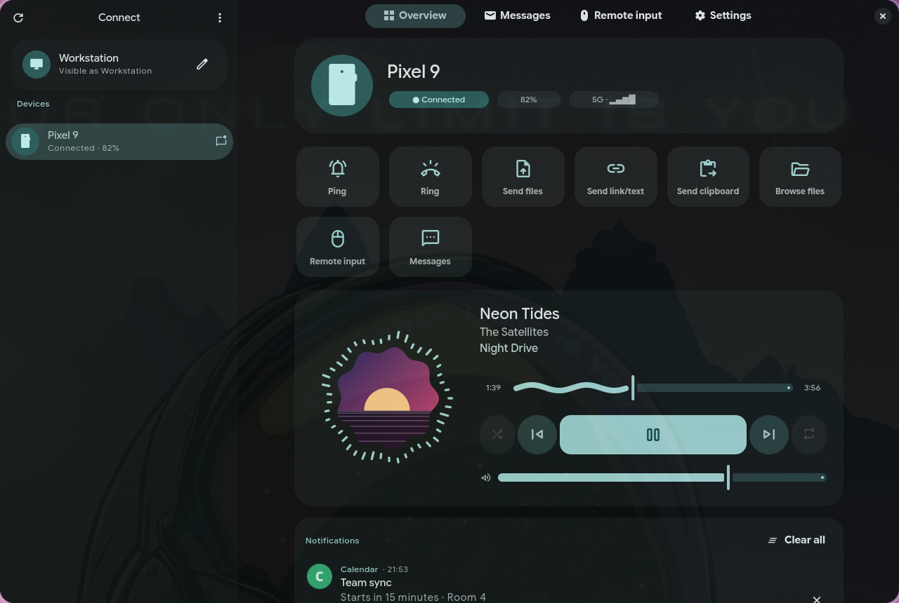
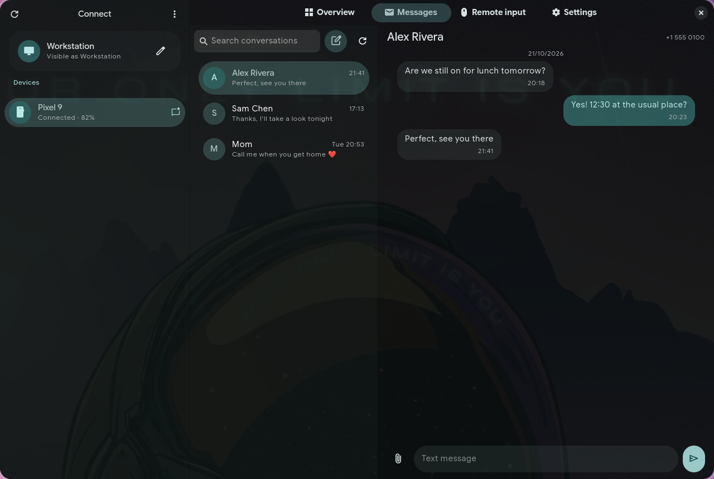
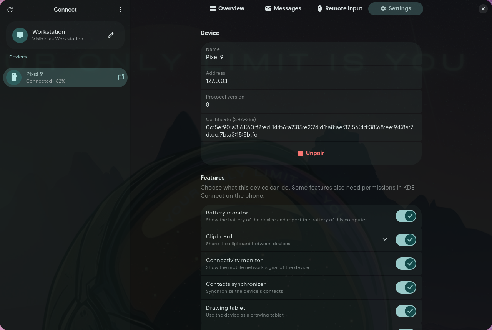
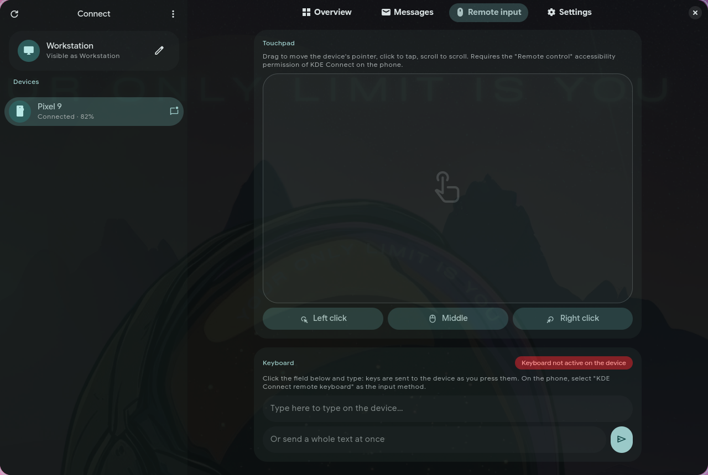

# Caelestia Connect

A KDE Connect compatible client for the [Caelestia shell](https://github.com/caelestia-dots/shell), written
from scratch in Python and GTK4. It works with the official KDE Connect Android app and needs no KDE or Qt
libraries.



| Messages | Settings |
|---|---|
|  |  |
| **Remote input** | |
|  | |

## Features

- Discovery over UDP broadcast and mDNS, and connections over Wi-Fi or Bluetooth
- Pairing with verification key
- Battery and mobile signal of the phone
- Phone notifications with actions, replies and dismissal
- Sending this computer's notifications to the phone
- Files, links and text in both directions
- Shared clipboard
- Phone media players in the shell's media widgets (MPRIS), and the phone as a remote for local players
- SMS and MMS conversations, with contact names
- Call notifications, muting, and pausing media during calls
- Ring the phone, or let the phone ring this computer
- Phone as touchpad and keyboard; remote control and keyboard for the phone
- Sharing this computer's mouse and keyboard with the phone: move the cursor past a screen edge
- Commands the phone can run on this computer
- System volume, screen lock, presentation remote and drawing tablet
- Browsing the phone's files
- Another computer running KDE Connect as an extra monitor
- Bar icon and popout in the Caelestia shell

## Installation

Dependencies on Arch Linux:

```sh
sudo pacman -S --needed python-gobject libadwaita python-cryptography python-evdev wl-clipboard libpulse
sudo pacman -S --needed sshfs gtk4-layer-shell   # optional: file browsing, presentation pointer
sudo pacman -S --needed wayvnc freerdp           # optional: virtual monitor
```

Install:

```sh
./install.sh
```

This installs `caelestia-connect`, `caelestia-connectd` and `caelestia-connect-cli` in `~/.local/bin`, enables
the `caelestia-connectd` user service, adds the desktop entry, icon and Nautilus extension, and integrates
the shell. Restart the shell afterwards.

If a firewall is active, open the KDE Connect ports:

```sh
sudo ufw allow 1714:1764/udp && sudo ufw allow 1714:1764/tcp
```

Uninstall with `./install.sh --uninstall` (pairing data in `~/.config/caelestia-connect` is kept).

## Shell integration

`caelestia/integrate.py` copies the QML files into the shell and applies small, marked patches to the status
icons and the bar popouts. It can be re-run safely and reverted with `--uninstall`; the original files are
kept as `.orig`. To patch another checkout, use `--shell <dir>`.

The icon is placed next to bluetooth. To choose its position, add `{"id": "kdeConnect", "enabled": true}`
to `bar.statusIcons` in `shell.json`.

## CLI

```sh
caelestia-connect-cli list
caelestia-connect-cli ping "hello"
caelestia-connect-cli share photo.jpg https://example.com
caelestia-connect-cli send-clipboard
caelestia-connect-cli sms +15551234567 "message"
caelestia-connect-cli media PlayPause
caelestia-connect-cli ring
caelestia-connect-cli call <plugin> <action> '<json args>'
caelestia-connect-cli watch
```

## Development

```
caelestia_connect/
  daemon.py, api.py   background service and the methods it exposes over IPC
  lan.py              discovery, TLS links and payload transfers
  mdns.py             mDNS responder and browser
  bluetooth.py        RFCOMM links over BlueZ, with KDE Connect's channel multiplexing
  device.py           pairing and packet routing
  plugins/            one module per feature
  desktop/            notifications, MPRIS, clipboard, audio, input, power and session
  ui/                 GTK4 app
  cli.py              command line client
caelestia/            shell QML and integrate.py
data/                 desktop entry, icon, systemd unit and Nautilus extension
tests/                fake Android peer, end-to-end test and demo
```

```sh
ruff check . && ruff format --check .
python3 tests/test_mdns.py && python3 tests/test_bluetooth.py
python3 tests/run_integration.py <local-ip>   # stop caelestia-connectd and close the app first
python3 tests/demo.py                         # demo phone, no real device needed
```

## Notes

- **Bluetooth:** pair the phone with the computer in the system Bluetooth settings and enable Bluetooth in the
  KDE Connect app settings. Wi-Fi is preferred when both are available; file browsing needs Wi-Fi.
- **Mouse and keyboard sharing** is off by default: enable *Share mouse and keyboard* in the device settings
  and choose the screen edge. The phone needs the *Mouse receiver* plugin and its accessibility permission.
  Moving the pointer back past the phone's edge returns it; Ctrl+Alt+Esc always does.
- **Virtual monitor** works between computers (the Android app has no support for it). Extending this
  computer's display needs `wayvnc`; showing another computer's virtual monitor needs FreeRDP, Remmina or KRDC.

## License

GPL-3.0-or-later
